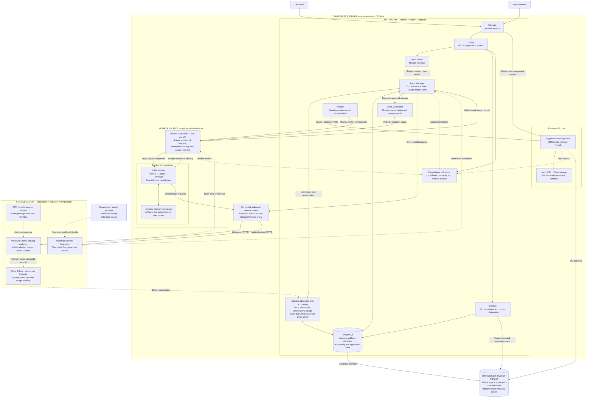

# Proposed architecture: direct Google model access

Local factory orchestration and VM workers, with direct calls to managed Gemini on Google Cloud. LiteLLM and the existing LiteLLM-backed Keybroker are removed from this proposed design. This is a target architecture, not a record of deployed services.

## Boundaries and assumptions

- Workers call Google directly; no LiteLLM or inference proxy remains.
- Local mission accounting, direct Google client integration, and VM provisioning automation require implementation.
- Google access tokens do not enforce per-mission dollar limits. Google project/service spend caps complement local accounting and are not instantaneous.
- Credential arrows describe logical delivery, not independent inbound connections from Google. Authentication and inference use controlled outbound HTTPS.
- The PostgreSQL node groups application databases conceptually; it does not prescribe merging the existing separate database services.
- Forgejo remains a collaboration service. The diagram does not imply that the current worker mission path checks out or pushes repositories.
- Worker VMs and application state remain on-premises, but model requests and their supplied content are processed in Google Cloud.
- View this file in a Markdown preview with Mermaid support, such as GitHub's rendered file view or a Mermaid-enabled editor preview.
