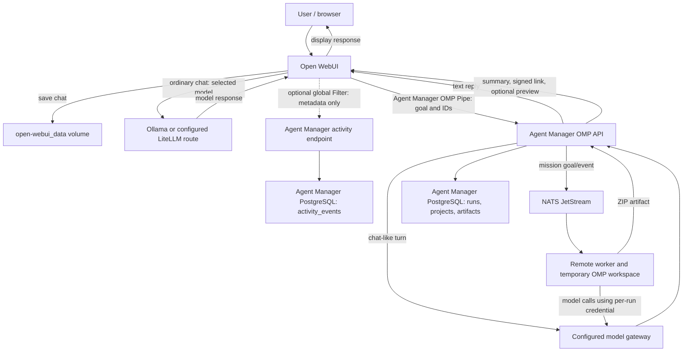

# Open WebUI → Agent Manager: data-handling handover

**Audience:** mission-integration reviewers  
**Purpose:** map where prompts, responses, mission artifacts, identifiers, and credentials travel or persist, and identify the live-deployment facts that still need confirmation.

> This describes repository configuration and code paths, not a live-system audit. The deployed Compose files, saved Open WebUI Functions, private `.env` files, model-provider route, backups, and retention settings may differ. Do not add credentials or real user prompts to this document.

## Executive summary

- Open WebUI is the primary chat-history store. Its Compose service mounts the persistent Docker volume `open-webui_data` at `/app/backend/data`; absent a live override, Open WebUI's default SQLite database is normally `/app/backend/data/webui.db`.
- The optional global activity Filter sends **metadata only** to Agent Manager. It does not forward prompt text, model responses, attachments, or API keys.
- Selecting the **Agent Manager OMP** Pipe is different: a mission's full goal is written to Agent Manager PostgreSQL and included in the NATS run event sent to a worker. A new project also stores the goal as its project brief. Completed output ZIP bytes are stored in PostgreSQL.
- Agent Manager's dashboard trace is deliberately content-free, but its authenticated `/v1/runs` response includes `goal` and run metadata. Treat Manager API access and database access as access to mission prompt content.
- Artifact URLs expire after seven days; the default artifact-blob retention is 30 days. Those controls do **not** delete Open WebUI chat history, run/project prompt records, NATS messages, backups, or any provider-side records.
- The effective model provider and its retention terms cannot be determined from this repository alone. The live LiteLLM `LUNA_API_BASE` / `LUNA_MODEL` settings decide where OMP requests go.

## End-to-end flow

Ordinary chats bypass Agent Manager unless an Agent Manager Pipe is selected. The global Filter is an independent, optional metadata feed; it does not make ordinary chats into Manager runs.

## Storage inventory

| Component | Persistent location | Data stored or handled | Retention / review note |
|---|---|---|---|
| Open WebUI | Named Docker volume `open-webui_data`, mounted at `/app/backend/data` (`Docker-Documents/open_webui_services/compose.yml`). Default database is normally `webui.db` in that directory. | Chat messages and assistant replies, user/settings data, and Open WebUI-managed data/files. | The repository does not define an automatic chat-retention period. Confirm any live DB URL override, user deletion behavior, backups, and backup retention. |
| Agent Manager PostgreSQL | Named volume `agent-manager_postgres_data`, mounted at `/var/lib/postgresql/data` (`Docker-Documents/agent-manager-service/compose.yml`). | Run goals, run status/metadata, project briefs and chat-to-project bindings, activity events, and uploaded ZIP artifact bytes (`mission_artifacts`). | Artifact blobs default to 30 days (`ARTIFACT_RETENTION_DAYS`); a cleanup loop checks daily. Cleanup removes the blob and its metadata reference, but does not purge the run or project prompt records. No general run/project prompt purge is defined in the inspected code. |
| Agent Manager NATS JetStream | Named volume `agent-manager_nats_data`, mounted at `/data`. | Persistent run/worker events. The run-created event contains the mission goal and run metadata; the upload capability is also delivered to the worker in the event metadata. | Streams use file storage and `RetentionPolicy.LIMITS`; the checked-in stream setup does not set a project-specific `max_age`, `max_bytes`, or `max_msgs`. The event's `expires_at` is an application-level queue expiry, not proof that the stored NATS message was deleted. Confirm the live stream limits and purge policy. |
| Worker | Remote worker host; an ephemeral OMP job container and temporary workspace. | Mission input, working files, model context, and temporary output while the run executes. | Completed/cancelled workspaces are cleaned. A `needs_input` mission preserves a worker-local checkpoint until clarification or cancellation. Confirm host-level cleanup, disk encryption, and backup/snapshot policy. |
| LiteLLM PostgreSQL | Named volume `litellm_postgres_data`, mounted at `/var/lib/postgresql/data`. | LiteLLM gateway database, including virtual-key and budget/spend-related state. | It is separate from Open WebUI chat history and Agent Manager mission storage. Do not assume it contains no request data without checking the deployed LiteLLM version and logging configuration. Checked-in config sets `set_verbose: false`; that alone does not establish provider or infrastructure log retention. |
| Model backend/provider | Determined by the selected Open WebUI connection or the live LiteLLM route. | Prompts, attachments included in requests, and model context needed for inference. | Repository defaults point the `luna` alias at the local llama service, but live `LUNA_API_BASE` and `LUNA_MODEL` may override this. If routed to an external provider, its processing, retention, and training terms apply. |

For the current Ansible inventory, the deployed Open WebUI Compose project is expected under `/home/infra-lab-user/open-webui-service`; the repository copy is `Docker-Documents/open_webui_services`. The actual Docker volume mountpoint is engine-specific. Verify it on the service host instead of assuming `/var/lib/docker`.

## Request and response paths

### 1. Ordinary Open WebUI chat

1. The browser submits a chat turn to Open WebUI.
2. Open WebUI sends the request to the selected model connection. The Compose default exposes Ollama internally as `http://ollama:11434`. A separately configured OpenAI-compatible connection may send the request to LiteLLM (`http://litellm:4000/v1`) using the `luna` alias.
3. The response returns to Open WebUI, is shown in the chat, and is part of Open WebUI's persisted chat history.
4. Ordinary direct-to-model chats do not create Agent Manager mission runs.

The `luna` alias is not proof of a local model. Its actual upstream is configured by the live LiteLLM `.env`; inspect the effective route and provider terms before sending restricted data. Never paste `.env` values or keys into review notes.

### 2. Optional Open WebUI activity Filter

When `openwebui_activity_filter.py` is installed as an active, global Filter, its inlet/outlet hooks post start/completion events to `POST /v1/openwebui/activity`. The payload contains event/turn IDs, phase, user ID/name, model ID, and chat ID. The Manager stores these values and timestamps in `activity_events`; the dashboard Activity feed can display user/model/chat metadata.

The Filter does not include message bodies, model responses, images/files, or API keys. Delivery is best-effort and should not block the model response. The Filter source saved inside Open WebUI is separate from the repository copy; editing this file or rebuilding Compose does not update the saved Function.

### 3. Agent Manager OMP Pipe: conversational answer

The Pipe extracts the latest user instruction and relevant Open WebUI user/chat identifiers, then posts to `POST /v1/omp/turns`. For a chat-like turn, Agent Manager calls its configured model gateway and returns the answer to Open WebUI. Agent Manager records a short title and a status/result summary for this chat path, not the full prompt and response; Open WebUI still holds the chat transcript.

OMP image questions are sent as inline image data to Luna's multimodal endpoint, not to a worker mission. The Pipe accepts up to four supported image data URLs (PNG, JPEG, WebP, GIF; 5 MiB each, 20 MiB total). Confirm the live model route supports image input and is approved for the image data.

### 4. Agent Manager OMP Pipe: mission

1. The Pipe sends the resolved mission goal plus routing/project fields and identifiers to Agent Manager. It can also send inline image bytes for the separate image-chat path; image-based artifact modifications are rejected.
2. Agent Manager records the full mission goal in `runs.goal` and mission metadata. A new OMP project records the initial goal as `omp_projects.brief`; project context can reuse a brief and recent run goals in later missions. The project/chat binding stores user, requester, conversation, and project identifiers.
3. Agent Manager publishes a run-created event to NATS. That event contains the goal and mission metadata. A worker consumes it and creates a temporary OMP workspace. Mission execution does not clone or push the configured Forgejo repository.
4. The worker obtains a run-scoped, short-lived model credential through Keybroker, calls the configured model route, packages approved output files into a ZIP, and uploads the ZIP to Agent Manager over TLS using a run-scoped upload capability. The provider/master key remains in LiteLLM's private deployment configuration.
5. Agent Manager stores the ZIP bytes in `mission_artifacts`. Open WebUI receives the completion summary and a signed download link; eligible HTML bundles may also have a sandboxed preview. The assistant reply/link is part of the Open WebUI chat history.

The worker progress trace is an allowlisted, bounded summary of phases/counts/status, not a prompt, model reasoning transcript, generated source tree, or raw stdout/stderr. This does not mean the mission prompt is absent from storage: it is persisted in PostgreSQL and included in the NATS event, and the authenticated `/v1/runs` API serializes `goal` and metadata. Restrict those APIs and service credentials accordingly.

## Credentials and security boundaries

- Keep the Pipe's `AGENT_MANAGER_API_TOKEN`, the activity Filter's `AGENT_MANAGER_OPENWEBUI_TOKEN`, Agent Manager's `MODEL_API_KEY`, Keybroker-issued worker credentials, LiteLLM administration keys, and the upstream provider key separate. These tokens serve different paths and scopes.
- OMP conversational chat redacts the configured model key and a limited set of recognized credential patterns before model forwarding/response display. Worker code also detects selected credential patterns. These are not general-purpose DLP controls; do not put secrets, private keys, access tokens, or sensitive source material into prompts or generated artifacts.
- Agent Manager's exposure-alert path stores and forwards a signed, secret-free alert; the raw credential, prompt, and model output are not placed in that event. This is a detection/alert path, not proof that all sensitive content is found or that a human was notified.
- Signed artifact URLs are bearer capabilities: anyone holding a valid link can access the artifact until it expires. Treat links as sensitive; do not copy them into public tickets or logs.
- Prompt confidentiality depends on the selected model backend. If a route is external, prompt text, supplied image data, and relevant project context are sent to that provider for inference. Provider retention is outside the guarantees of this repository.

## Retention and deletion gaps to resolve

| Data | Code-level behavior | Integration review action |
|---|---|---|
| Open WebUI messages/files | Persistent data volume; no repository-defined automatic retention period. | Decide retention, user deletion, administrator deletion, backup expiry, and restore behavior. |
| Mission prompts and project briefs | Stored in run/project rows; project context reuses brief and recent goals. | Define a prompt/run/project retention and deletion policy. Artifact expiry alone does not erase these records. |
| NATS run events | File-backed JetStream stream; no explicit per-stream age/size cap is set in the checked-in stream setup. | Inspect live stream configuration, limits, backups, and purge behavior; verify how acknowledged/expired messages are eventually removed. |
| Artifact ZIPs | Default database blob retention is 30 days; download/preview signatures expire after 7 days. | Confirm live `ARTIFACT_RETENTION_DAYS`, cleanup task health, and whether database backups retain expired blobs. |
| Worker workspace/checkpoint | Removed after completed/cancelled runs; `needs_input` preserves a checkpoint. | Decide maximum checkpoint age and verify disk/snapshot cleanup for offline or failed workers. |
| LiteLLM/provider/system logs | Not fully specified by this repository. | Confirm LiteLLM request logging, reverse-proxy/container log retention, provider data-use/retention, and any observability exports. |

The 7-day URL expiry is not artifact deletion. The 30-day artifact cleanup is not a mission-record purge. Deleting a chat, if enabled operationally, should not be assumed to delete its Manager run, NATS event, worker checkpoint, artifact, or provider-side copy.

## Review checklist for mission integration

- [ ] Confirm the live Open WebUI Compose project, image/version, named volumes, database URL, and host mountpoints.
- [ ] Confirm which saved Open WebUI Pipe and global Filter source/valves are active; compare them with the repository source without exposing token values.
- [ ] Trace each approved model selection to its actual local/external backend, including image handling and provider retention terms.
- [ ] Review access to Open WebUI chat exports/database backups, Agent Manager PostgreSQL, the `/v1/runs` APIs, NATS, worker disks, artifact endpoints, and LiteLLM logs.
- [ ] Set explicit retention/deletion requirements for chat transcripts, mission goals/project briefs, NATS events, artifacts, checkpoints, logs, and backups; test deletion end to end with synthetic data.
- [ ] Confirm the user-facing notice/approval for sending prompts, project context, images, or generated artifacts to an external model provider.
- [ ] Confirm generated artifacts are treated as untrusted files; the worker
  does not execute them or modify Forgejo. HTML previews are inert in chat, but
  the **Open interactive preview** link runs client-side JavaScript in a
  standalone response-CSP sandbox with an opaque origin. Review blocked
  network APIs, remote subresources, forms, nested frames, and workers; it is
  not a server-side runtime or an inert file.
- [ ] Record any live configuration differences and the owner for each unresolved retention/access decision.

## Repository references

- [Open WebUI Compose and integration guide](../Docker-Documents/open_webui_services/README.md)
- [Open WebUI Compose file](../Docker-Documents/open_webui_services/compose.yml)
- [Agent Manager Pipe](../Docker-Documents/open_webui_services/agent_manager_pipe.py)
- [Metadata-only activity Filter](../Docker-Documents/open_webui_services/openwebui_activity_filter.py)
- [Agent Manager OMP request and persistence](../Docker-Documents/agent-manager-service/agent_manager/omp.py)
- [Agent Manager data models](../Docker-Documents/agent-manager-service/agent_manager/models.py)
- [Artifact storage and expiry](../Docker-Documents/agent-manager-service/agent_manager/artifacts.py)
- [Agent Manager Compose volumes](../Docker-Documents/agent-manager-service/compose.yml)
- [Worker lifecycle and trace contract](../agent-worker/README.md)
- [LiteLLM configuration](../Docker-Documents/litellm-service/config.yaml)
- [Security boundaries and incident response](dark-factory-security-boundaries.md)
