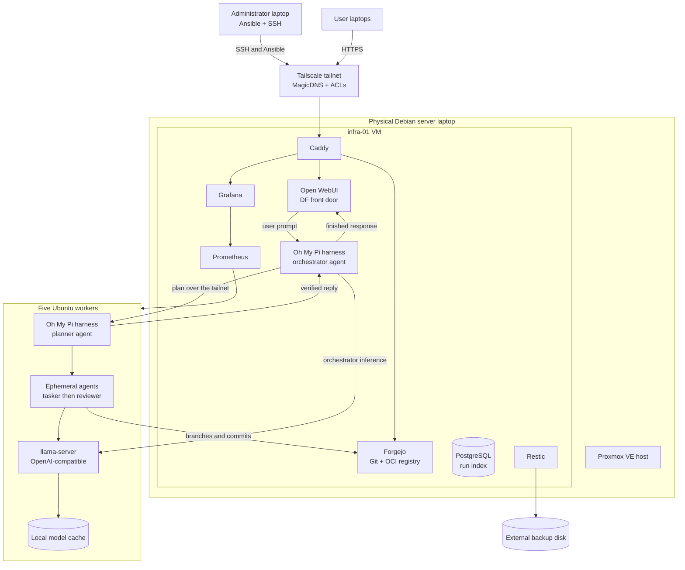

# Small AI Lab Architecture Using Free and Open-Source Software

## Scope

This is the deliberately small first version of the lab.

Current hardware and state:

- One Debian server laptop
- Five Ubuntu worker laptops
- 32 GB RAM and approximately 512 GB SSD per laptop
- Intel integrated Arc graphics on the laptops
- Tailscale tailnet already configured
- No other services currently deployed

The goal is a useful multi-node AI and software-agent lab without Kubernetes, a custom job bus, high-availability storage, or a large number of services.

## Plan changes in this revision

Removed from this version:

- Element Web, Conduit, Matrix, and coturn. Open WebUI is the only user-facing channel.
- NATS JetStream as the agent job bus.
- The `agent-control` service, the supervisor, and fixed coder/reviewer laptop roles.
- Garage S3 as a first-version dependency. Evidence stays on the worker that produced it and is copied to the server. S3 can return later as a thin evidence layer.

Added:

- Open WebUI as the front door into the Dark Factory (DF).
- An [Oh My Pi](https://github.com/can1357/oh-my-pi) harness on the server. Its root agent is the **orchestrator**. The orchestrator writes a plan.
- An Oh My Pi harness on each worker. A dispatched plan starts a **planner** agent there. The planner writes the task list and spawns **ephemeral** agents.
- The usual ephemeral loop is a tasker (often a coder) into an independent reviewer. The planner chooses the types. A software-engineering plan uses coder, reviewer, tester, and security reviewer.

Companion: `worker-topology.md`.

---

# 1. Recommended Small-Lab Architecture



Open WebUI does not talk to worker models for Dark Factory work. It prompts the server harness. Direct Open WebUI-to-llama-server chat remains a GPU bring-up test only.

The five workers are Intel Ultra 5 laptops with 32 GB RAM, Intel Arc graphics, and 512 GB SSDs. They stay bare metal so the GPU stack has direct hardware access. The Debian server runs Proxmox VE and does not run inference.

### Proxmox placement

Proxmox VE runs on the Debian server laptop. It hosts `infra-01`, which runs the control-plane Compose stack and the server Oh My Pi harness. The Proxmox host stays minimal: no Forgejo, PostgreSQL, Docker, or agent sessions on the host.

Workers do not run Proxmox. GPU passthrough is not a prerequisite for this lab.

```text
infra-01 VM
  4–6 vCPUs
  12–16 GB RAM
  100–150 GB virtual disk
  Bridged network interface
```

Use ext4 or LVM-thin on the server SSD. Do not add ZFS or Ceph on one 512 GB laptop disk.

---

# 2. Small-Lab Service List

## Services to deploy first

| Service | Placement | Why it is needed | Interactions |
|---|---|---|---|
| Tailscale | All machines | Private encrypted connectivity. Already installed. | Admins reach SSH. Users reach HTTPS on `infra-01`. The orchestrator reaches one worker harness. Workers reach Forgejo and, for the orchestrator model, are reached on `:8080`. |
| MagicDNS | Tailscale | Stable names. | Ansible, SSH, Caddy, and dispatch use names, not drifting addresses. |
| Tailscale ACLs and tags | Tailscale admin | Separates users, admins, server, and workers. | Users reach Caddy only. The DF dispatch key reaches worker SSH with a forced command. Workers do not talk to each other. |
| SSH | All machines | Admin transport, Ansible, and DF dispatch. | Admin keys are interactive. The dispatch key on `infra-01` can only start a worker planner session. |
| Ansible | Administrator laptop at first | Repeatable host and service config. | Configures Proxmox, `infra-01`, and all five workers from one worker role. |
| UFW or nftables | All machines | Host firewall. | Tailscale, SSH, HTTPS, metrics, model API from the server, and nothing else. |
| Chrony or systemd-timesyncd | All machines | Clock sync. | TLS, logs, metrics, and run timestamps. |
| Docker Engine + Compose | `infra-01` and workers | Containers without Kubernetes. | Control-plane stack on the VM. Sandboxes and optional llama-server on workers. Never on the Proxmox host. |
| Caddy | `infra-01` | One HTTPS entry. | Routes to Open WebUI, Forgejo, and Grafana. Does not publish PostgreSQL, the Docker socket, or llama-server. |
| Forgejo | `infra-01` | Git, review, issues, CI definitions. | Uses PostgreSQL. Agents clone and push `agent/<run>/<task>` branches. Humans merge protected branches. |
| Forgejo OCI registry | `infra-01` | Images from CI. | Runners push. Workers pull approved images. |
| PostgreSQL | `infra-01` | Forgejo metadata and the DF run index. | Separate databases and users. The run index is status and pointers, not the live task list. |
| Prometheus | `infra-01` | Host, container, and inference metrics. | Scrapes Node Exporter and llama-server. |
| Node Exporter | Proxmox host, VM, workers | CPU, RAM, disk, temperature. | Prometheus scrapes each node. |
| Grafana | `infra-01` | Dashboards. | Queries Prometheus. Reached through Caddy. |
| Restic | `infra-01` | Encrypted backups. | Backs up databases, Forgejo, harness session archives, and staged evidence to an external disk. |
| Proxmox VE | Debian server laptop | VM lifecycle and snapshots for `infra-01`. | Ansible manages the host API and the guest separately. |
| llama-server (Vulkan) | Every Ubuntu worker | Local inference on Intel GPU/CPU. | OpenAI-compatible `:8080`. Serves the worker's planner and ephemeral agents. Also serves the server orchestrator when that worker is not executing a plan. |
| Open WebUI | `infra-01` | Front door into the Dark Factory. | Prompts the server Oh My Pi harness. Returns the orchestrator's finished response in the same conversation. |
| Oh My Pi harness | `infra-01` and every worker | Agent runtime. Subagents, isolated workspaces, session transcripts. | Server session root is the orchestrator. Worker session root for a dispatched plan is the planner. The planner spawns ephemeral agents with the harness `task` tool. |
| DF front door | `infra-01`, beside Open WebUI | Keeps one server harness RPC session per Open WebUI conversation. | Accepts the user prompt, drives `omp --mode rpc`, streams status back, and posts the finished response. It does not plan or spawn workers. |
| DF dispatch helper | `infra-01` | Sends a plan to one worker and waits for the planner reply. | Holds the forced-command SSH key. The orchestrator calls it. The orchestrator does not hold a shell key. |

## Services to add only when a concrete need appears

| Service | Why it waits | Later use |
|---|---|---|
| LiteLLM or another gateway | Five direct OpenAI-compatible endpoints are enough to start. | One route for orchestrator and worker inference, with fallback. |
| Loki + Alloy or Promtail | journald and Docker log rotation cover bring-up. | Search harness and sandbox logs once runs are frequent. |
| OpenTelemetry + Tempo or Jaeger | One worker session is still readable as a transcript. | Cross-service timing after the happy path is boring. |
| Proxmox metrics exporter | Node Exporter covers the host. | VM state in Prometheus. |
| Trivy | CI images do not exist yet. | Scan Forgejo OCI images and worker filesystems. |
| SOPS with age, or Ansible Vault | Local secrets are enough for one operator. | Required before the Ansible repo is shared. |
| Garage or MinIO | Evidence-on-disk plus Restic covers this lab. | Thin S3 layer for evidence if workers must not keep it. |
| K3s | Operational cost exceeds the five-laptop lab. | Only if container scheduling outgrows Compose and systemd. |
| Authentik or Authelia | Tailscale ACLs plus application accounts are enough. | SSO for Forgejo, Grafana, and Open WebUI. |
| Headscale | The current Tailscale control plane works. | Self-hosted coordination if required. |

Element, Conduit, Matrix, and coturn are not on this list.

---

# 3. Dark Factory Workflow

The Dark Factory is the closed agent loop. A person submits a goal in Open WebUI and later receives a finished response there. The person is outside the repetitive loop and inside governance: merge, deploy, secrets, infrastructure changes, and security overrides still stop for a human.

Two harnesses. Two long-lived agents for a run. Then short-lived specialists.

```text
User
  -> Open WebUI                         [infra-01, the DF front door]
  -> Oh My Pi RPC session               [infra-01]
  -> orchestrator writes a plan         [server harness]
  -> dispatch helper                    [tailnet SSH, forced command]
  -> Oh My Pi RPC session               [one worker, lab-gpu-NN]
  -> planner writes a task list         [worker harness]
  -> ephemeral agents do the tasks      [same worker, child sessions]
  -> planner verifies every task
  -> planner reply returns
  -> orchestrator completes the plan
  -> finished response in Open WebUI
```

## 3.1 Who decides what

| Agent | Where | Lifetime | Decides | Does not |
|---|---|---|---|---|
| Orchestrator | Server harness. Root of the Open WebUI session. | One conversation. | The plan: outcome, constraints, repository, acceptance criteria, approval gates. Which free worker receives it. When the returned result completes the plan. | Break the plan into implementation tasks. Write code. Review code. Hold SSH keys. |
| Planner | Worker harness. Root of the per-plan session. | One dispatched plan. | The task list. Which ephemeral types to spawn, in what order, and whether to retry. Whether every task is actually done. | Talk to the user. Mark the server plan complete. Merge a protected branch. |
| Ephemeral tasker | Child session on that worker. Often a coder. | One task. | How to finish the assignment it was given. | Review its own output. Spawn the next reviewer. See another agent's transcript. |
| Ephemeral reviewer | Child session on that worker. Type chosen by the planner. | One review. | Pass, fail, or changes requested, against the criteria it was given. | Reuse the tasker's workspace or conversation. Declare the plan done. |

The planner picks the types. The average loop is a tasker into a reviewer: produce, then check, in separate sessions. A software-engineering plan should include a coder, a reviewer, a tester, and a security reviewer. Other plans use other taskers and other reviewers. A documentation plan does not grow a security-reviewer step it does not need. A research plan does not grow a coder step it does not need.

Bundled Oh My Pi agents already cover part of this (`task`, `reviewer`, `security-reviewer`, `scout`). The lab adds project agents for `planner`, `coder`, and `tester` under the worker workspace `.omp/agents/`. The server workspace defines `orchestrator` and does not define the worker specialists.

## 3.2 What crosses the tailnet

The orchestrator sends a plan, not a task queue. The plan is the planner's prompt. Minimum fields:

```text
run_id
goal                  the user request, unchanged
outcome               what "done" means for this plan
repository            Forgejo repo, or "none"
constraints           branches that must not be touched, time, tools
acceptance            checks the planner must satisfy before replying
approval_gates        merge, deploy, secrets, infrastructure
```

The planner reply is the only result that travels back. It includes the task list it actually ran, pass/fail per task, Forgejo refs, evidence paths, and the finished product the orchestrator should return. Partial task chatter stays on the worker.

Dispatch is Tailscale SSH from `infra-01` to `lab-gpu-NN` with a forced command:

```text
omp --mode rpc
```

started in that run's workspace, with the planner as the root agent. The plan is the first prompt. The planner's final reply is the command result. The key cannot open a shell, read the worker's admin files, or start a second plan on a busy worker.

Worker choice: any worker with no active plan. All five run the same image. One plan per worker. A sixth laptop joins by running the same Ansible role and receiving a MagicDNS name.

## 3.3 Ephemeral loop

Child sessions start blank. They do not inherit the planner's conversation or a sibling's transcript. The planner puts the assignment, the acceptance criteria, and the Forgejo ref in the task text. That is the whole handoff.

Software-engineering shape, when the planner decides the plan is a code change:

```text
1. scout, optional     map the repo; read-only
2. coder               isolated workspace; branch agent/<run>/<task>; push
3. reviewer            fresh checkout of that ref; correctness only
4. tester              fresh checkout; build, test, lint, typecheck
5. security-reviewer   fresh checkout; diff and dependency findings
6. planner             every required task passed, or retry, or stop
```

If the reviewer or the tester fails, the planner spawns another coder attempt, then runs the failed checker again. The coder does not grade itself. Max attempts is 3, then the planner replies `blocked` and the orchestrator asks the user in Open WebUI.

A non-code plan uses the same shape with different types. Example: a tasker drafts an answer, a reviewer checks it against the source the planner named. The planner still verifies before it replies.

Code-changing agents use the harness isolated workspace. Reviewers and testers check out Forgejo. They do not open the coder's worktree. Same laptop is normal. Separate session and fresh checkout are the independence boundary, not a dedicated reviewer machine.

## 3.4 Return path

```text
planner verifies the task list
  -> reply to the dispatch helper
  -> orchestrator reads the reply against the plan's acceptance criteria
  -> orchestrator yields the finished response
  -> DF front door posts it to the Open WebUI conversation
```

The orchestrator does not re-run the tasks. If the reply misses an acceptance criterion, it sends the plan back once with the gap named. A second miss is an Open WebUI escalation, not a silent retry loop on every worker.

Approval gates never complete inside the worker. The planner stops and reports the gate. The orchestrator posts the ask in Open WebUI. Merge to a protected branch, deploy, secret access, infrastructure change, and overriding a security finding wait there.

## 3.5 Inference

The server VM has no GPU. Before each orchestrator turn, the DF front door sets that server session's model URL to `http://<magicdns>:8080/v1` on a worker whose state is `free`. It never points at the worker executing this plan. If every worker is busy, the turn waits. It does not steal the coder's context window.

On the execution worker, llama-server is the only GPU consumer. Ephemeral agents call `http://127.0.0.1:8080/v1`. The default loop is serial: tasker, then reviewer. A 32 GB shared-memory laptop does not run two large contexts at once. The planner may overlap read-only checkers only after a measured run shows the endpoint still has capacity.

Start with 7B or 8B quantized models. 10B–14B only if a benchmark on this hardware accepts the latency and the memory left for the OS. Do not plan on 32B or 70B. One or two standard models on every worker, so a plan can land on any node. See `worker-topology.md` for the current filenames.

## 3.6 What is durable

| Fact | System of record | Not stored in |
|---|---|---|
| User goal and finished response | Open WebUI conversation, copied into the server harness session | NATS, chat logs as the only copy |
| Plan | Server harness session | The worker, except as the prompt it was given |
| Task list, ephemeral yields, planner verdict | Worker harness session, then a snapshot in the run index | A supervisor state machine |
| Current run status | PostgreSQL run index: `run_id`, conversation id, worker, status, plan path, reply path, timestamps | Grafana, scraped from logs |
| Source, branches, commits | Forgejo | Harness transcripts |
| Test logs, diffs, scan reports | `/srv/agent/evidence/<run>/<task>/<attempt>/` on that worker | PostgreSQL rows |
| Host and model numbers | Prometheus | The run index |

The run index is a pointer. The task list lives in the planner session until the planner yields, then the dispatch helper stores the reply snapshot. After that, the operator can read the result without the worker session.

Agents do not get Proxmox admin, Tailscale admin, Ansible private keys, the PostgreSQL superuser, the dispatch key, or the Docker socket.

---

# 4. Suggested 512 GB Storage Layout

Do not create rigid partitions yet. Watch usage. Keep at least 15–20% of each SSD free. Alert at about 75% and 85%.

## Debian server

The server does not store the model cache.

| Use | Approximate allocation |
|---|---:|
| Proxmox host OS | 40–60 GB |
| `infra-01` virtual disk | 100–150 GB |
| VM snapshots and rescue space | 80–120 GB |
| Unallocated margin | The rest, at least 80 GB |

Inside the `infra-01` disk: OS and Docker, Forgejo and its registry, PostgreSQL, Prometheus, and a small staging directory. The Restic repository and the long-term evidence copy live on the external disk, not in the VM disk.

## Each Ubuntu worker

All five use the same layout. There is no storage-node split.

```text
/                   50–70 GB     OS and packages
/var/lib/docker     50–80 GB     images, sandbox layers, runner cache
/srv/models        220–280 GB    GGUF cache
/srv/agent          60–80 GB     harness sessions, workspaces, checkouts, evidence
free                80–100 GB
```

```text
/srv/agent/sessions/<run_id>/          planner session and ephemeral artifacts
/srv/agent/workspaces/<run>/<task>/    coder isolated worktrees
/srv/agent/checkouts/<run>/<task>/     fresh reviewer and tester checkouts
/srv/agent/evidence/<run>/<task>/<attempt>/
```

A systemd timer deletes old sandbox layers, workspaces and checkouts from finished runs, evidence past the retention window, and unused model files. Nightly `rsync` copies `evidence/` and the planner reply snapshot to `infra-01` staging, then Restic writes the external disk.

---

# 5. Service Interactions

## 5.1 Diagnostic chat

Used once, to prove the GPU path, before the Dark Factory path is trusted.

```text
User laptop
  -> Tailscale
  -> Caddy
  -> Open WebUI
  -> llama-server on one worker
  -> Intel GPU
  -> response
```

This path is not the Dark Factory. Leave it available to admins for benchmarks. Users with a normal DF conversation never select it.

## 5.2 Dark Factory run

```text
Open WebUI conversation
  -> DF front door
  -> server omp --mode rpc
  -> orchestrator plan
  -> dispatch helper
  -> worker omp --mode rpc
  -> planner task list
  -> ephemeral tasker, then ephemeral reviewer
  -> planner verdict
  -> orchestrator finished response
  -> same Open WebUI conversation
```

No custom agent framework, no Temporal, no Ray, no queue service. Oh My Pi is the agent runtime on both sides. Add another control service only after this loop has failed in a way the harness cannot express.

## 5.3 CI

```text
Developer or coder pushes a branch to Forgejo
  -> Forgejo Actions runner on a worker
  -> tests and build
  -> optional Trivy scan, once images exist
  -> image pushed to the Forgejo OCI registry
```

Do not mount `/var/run/docker.sock` into untrusted agent or CI jobs. Runners are separate from the planner session. Prefer a worker that is not executing a plan.

## 5.4 Monitoring

```text
Workers, VM, and Proxmox host
  -> Node Exporter and llama-server metrics
  -> Prometheus
  -> Grafana
```

Run status comes from the PostgreSQL run index, not from a log scrape.

## 5.5 Backup

```text
PostgreSQL dumps + Forgejo data + Compose and Ansible
  + staged evidence and harness reply snapshots
  -> Restic
  -> external disk
```

An external disk in the same room is not a fire or theft copy. Add an off-site copy when the lab holds something that would hurt to lose.

---

# 6. Visibility

## 6.1 What the user sees in Open WebUI

- The goal they sent
- A short plan summary once the orchestrator has one
- Which worker took the plan
- Escalation asks, and only those asks
- The finished response

Not every model token. Not every ephemeral tool call.

## 6.2 What an operator can open

| Question | Where |
|---|---|
| Is the run queued, running, blocked, or done? | PostgreSQL run index, shown in Grafana or a small run view |
| What was the plan? | Server harness session |
| What tasks ran, and what did each agent yield? | Worker harness session and `agent://` artifacts, then the stored reply snapshot |
| What code changed? | Forgejo branch `agent/<run>/<task>` |
| Did tests or the security review fail? | `evidence/<run>/<task>/<attempt>/` |
| Is the laptop hot, full, or out of GPU memory? | Grafana |

## 6.3 Metrics worth collecting

Workflow: active runs, time to first plan, time to planner reply, attempts per task, blocked runs, approval wait.

Model: requests, latency, tokens/second, errors, which worker served the orchestrator, which worker served the plan.

Quality: files changed, tests passed or failed, lint and typecheck failures, security findings, review iterations.

Workers: CPU, RAM, disk, GPU temperature, sandbox failures, evidence directory size.

## 6.4 When to interrupt the user

Post into the Open WebUI conversation only when a person must act:

- The plan needs an approval the orchestrator was told to confirm
- A run is blocked after the attempt limit
- A security finding is high severity
- The agent wants a secret, a protected-branch merge, a deploy, or an infrastructure change
- The worker or the model endpoint died and no other worker can take the plan
- The run completed

Do not post task-started, heartbeat, or token-progress messages.

## 6.5 Visibility order

1. `run_id` on the Open WebUI conversation, the server session, the worker session, the branch, and the evidence path.
2. Run index row written when dispatch starts, updated when the planner replies or the session drops.
3. Code in Forgejo.
4. Reports on the worker disk, rsynced after the run.
5. Prometheus on every node.
6. One Grafana board for worker health and one for active runs.
7. Central logs only after transcript files are not enough.

---

# 7. Recommended Deployment Order

## Stage 1 — Record the current state

1. Debian version on the server.
2. Ubuntu version on each worker.
3. Tailscale names and addresses.
4. CPU, GPU, RAM, disk size, disk health.
5. SSH over the tailnet.

## Stage 2 — Proxmox and the Ansible baseline

Do not install Docker, Forgejo, PostgreSQL, or Oh My Pi on the Proxmox host.

1. Back up anything worth keeping on the current Debian install.
2. Install Proxmox VE.
3. Bridge and management network.
4. Tailscale on the Proxmox host.
5. Create `infra-01` (4–6 vCPUs, 12–16 GB RAM, 100–150 GB disk).
6. Install Debian or Ubuntu Server in the VM.
7. Ansible user and SSH keys on the VM and the workers.
8. Hostnames, updates, time sync.
9. Firewalls: Proxmox host, guest, workers.
10. Docker Engine and Compose on the VM and the workers only.
11. Node Exporter on the host, the VM, and the workers.
12. Disable worker sleep.
13. Intel GPU packages on the workers.

Prove one worker before cloning the role onto the other four.

## Stage 3 — Backups

1. Attach the external disk.
2. Restic repository on that disk.
3. Back up the Ansible repo and the baseline config.
4. Add PostgreSQL and Forgejo dumps after those services exist.
5. Write the restore steps and run them once into a scratch directory.

## Stage 4 — Control plane, without the agent loop

On `infra-01` only:

1. Caddy
2. PostgreSQL
3. Forgejo and the OCI registry
4. Prometheus and Grafana
5. Open WebUI

No NATS. No Element. No Conduit.

## Stage 5 — One GPU worker

1. Confirm `/dev/dri`.
2. `intel_gpu_top` or the equivalent that this stack actually ships.
3. llama-server on Vulkan, one 7B/8B model.
4. Admin diagnostic chat from Open WebUI to that endpoint.
5. Record tokens/second, temperature, memory, and what happens when memory runs out.

Then install the same inference role on the other workers.

## Stage 6 — Dark Factory path, one worker

1. Install Oh My Pi on `infra-01` and on `lab-gpu-01`.
2. DF front door: one Open WebUI conversation drives one server `omp --mode rpc` session.
3. Orchestrator agent definition on the server. It must produce a plan and call the dispatch helper, and it must not clone repositories.
4. Dispatch helper and the forced-command key.
5. Planner agent definition on the worker.
6. One non-code run: tasker, then reviewer, reply visible in Open WebUI.
7. One code run: coder, reviewer, tester, security reviewer, branch in Forgejo, evidence on disk, reply in Open WebUI.
8. Run index row for both.
9. Kill the worker mid-run once. Confirm the orchestrator reports failure instead of a false completion.

## Stage 7 — The other workers, then gates

1. Same harness role on `lab-gpu-02` through `lab-gpu-05`.
2. Two concurrent Open WebUI conversations land on two different workers.
3. A third conversation waits instead of sharing a busy worker.
4. Approval gate: a plan that wants a protected-branch merge stops in Open WebUI.
5. Resource limits and the 3-attempt cap.
6. CI on a free worker before any automatic merge exists. Automatic merge stays off.

## Stage 8 — Optional, only with a reason

LiteLLM, Loki, OpenTelemetry, Proxmox exporter, Trivy, SOPS, S3, Authentik, K3s, Headscale.

---

# 8. First Goal

```text
Proxmox on the Debian server
infra-01 running Caddy, PostgreSQL, Forgejo, Prometheus, Grafana, Open WebUI
Five identical Ubuntu workers, Ansible-managed, on the tailnet
llama-server on every worker, one model, diagnostic chat proven on one
Server Oh My Pi session: orchestrator writes a plan
One worker Oh My Pi session: planner writes tasks and spawns ephemeral agents
One software-engineering run: coder, reviewer, tester, security reviewer
Planner verifies, orchestrator replies, Open WebUI shows the finished response
Branch and commits in Forgejo
Evidence on the worker disk and in the run index
A killed worker does not look like success
Restic restore tested
Prometheus scraping every node
```

That is the lab. Matrix, a job bus, fixed reviewer laptops, and S3 are not part of reaching it.

---

# 9. Infrastructure Planes

Planes are responsibilities, not extra machines.

1. Management and virtualization
2. User and ingress
3. Dark Factory control
4. Worker compute
5. State and storage
6. Observability
7. Security

```text
Control plane     Orchestrator decides the plan and accepts the reply
Worker compute    Planner and ephemeral agents do the work
State plane       Remembers the goal, the code, the verdict, and the evidence
```

## 9.1 Management and virtualization

Proxmox VE, Ansible, SSH, Tailscale admin, host firewalls, time sync.

```text
Administrator laptop -> Tailscale -> SSH / Proxmox API -> host, infra-01, workers
```

If the server dies, a plan already running on a worker continues until its harness exits, and no new plan can be dispatched. Rebuild from Ansible and the VM backup. Do not put application services on the Proxmox host.

## 9.2 User and ingress

Tailscale, Caddy, Open WebUI, Forgejo web, Grafana.

```text
https://ai.<tailnet-domain>        Open WebUI, the DF front door
https://forgejo.<tailnet-domain>
https://grafana.<tailnet-domain>
```

```text
User laptop -> Tailscale -> Caddy -> Open WebUI, Forgejo, or Grafana
```

Caddy does not route to PostgreSQL, the Docker API, or llama-server. If Caddy fails, admins can still SSH. Users cannot.

## 9.3 Dark Factory control

DF front door, server Oh My Pi harness, orchestrator agent, dispatch helper, PostgreSQL run index.

This plane decides what should happen and which worker should do it. It does not execute untrusted code and it does not spawn ephemeral agents.

Failure: if the server harness dies, the Open WebUI conversation stops getting updates. A worker planner already running may finish locally; its reply is lost unless the dispatch helper reconnects and the session is still alive. The run index must show `unknown` or `failed`, never `completed`, until a planner reply is stored. Restart resumes the server session if the session file survived; it does not invent a verdict.

## 9.4 Worker compute

Oh My Pi on the worker, planner, ephemeral agents, llama-server, Docker sandboxes, Forgejo Actions runners, Intel GPU runtime.

```text
dispatch starts planner session
  -> planner spawns tasker
  -> tasker clones Forgejo, calls 127.0.0.1:8080, pushes agent/<run>/<task>
  -> planner spawns reviewer on a fresh checkout
  -> reviewer returns pass, fail, or changes
  -> planner repeats or replies
```

If the worker dies, the dispatch helper sees the session drop. The orchestrator retries on another free worker or escalates. Commits already in Forgejo survive. Evidence not yet rsynced may not. The next attempt regenerates it.

If llama-server dies, the planner reports the inference failure. It does not yield a successful product.

## 9.5 State and storage

| Component | Stores | Does not store |
|---|---|---|
| Open WebUI | The user conversation and the finished response | Task transcripts |
| Server harness session | Plan, dispatch decision, final reply | Worker worktrees |
| Worker harness session | Task list, ephemeral yields, planner verdict | The user-facing conversation |
| PostgreSQL | Forgejo metadata; run index | Model weights, Git objects, large logs |
| Forgejo | Source, branches, commits, pull requests | Job logs and model files |
| Forgejo OCI | Image manifests and layers | Run state |
| Worker SSD | Model cache, live workspaces, evidence | The only copy of a finished reply, after rsync |
| External Restic disk | Encrypted snapshots | Live state |

Restore PostgreSQL, Forgejo, and evidence separately. Restoring one does not restore the others.

## 9.6 Observability

Prometheus, Node Exporter, llama-server metrics, Grafana, journald. Loki and traces later.

```text
Run status          -> PostgreSQL run index
Plan and verdict    -> harness sessions
Code                -> Forgejo
Large evidence      -> worker disk, then staging
Numbers             -> Prometheus
User-facing alerts  -> the Open WebUI conversation
```

Three depths: overview (active runs, blocked runs, worker health), run timeline (plan, tasks, verdicts, retries), evidence (diff, logs, scans, tool calls).

## 9.7 Security

```text
Tailscale ACLs     who can reach which machine
UFW/nftables       which ports answer
Dispatch key       forced command only, one plan per worker
Application users  Forgejo and PostgreSQL, separate from agents
Sandbox            filesystem, network, CPU, RAM, no Docker socket
Branch protection  no autonomous merge to protected branches
Open WebUI gate    merge, deploy, secrets, infrastructure, security override
```

Ephemeral credentials can push `agent/*` branches and cannot push protected branches. The planner cannot read the dispatch key. The orchestrator cannot read worker admin keys.

## 9.8 One run across planes

```text
1.  User submits a goal in Open WebUI.
2.  Ingress reaches the DF front door through Caddy.
3.  Server harness orchestrator writes a plan.
4.  Run index row is created.
5.  Dispatch helper opens a planner session on one free worker.
6.  Planner writes a task list and spawns ephemeral agents.
7.  Coder pushes a branch to Forgejo. Reviewer and tester use fresh checkouts.
8.  Evidence lands on that worker's disk.
9.  Planner verifies and replies.
10. Orchestrator checks the reply against the plan.
11. Finished response is posted to the same Open WebUI conversation.
12. A human is asked only if a gate or a hard failure requires it.
```

The chain of evidence is the conversation, the plan, the task list, the Forgejo refs, and the evidence directory. No other bus sits in the middle.
